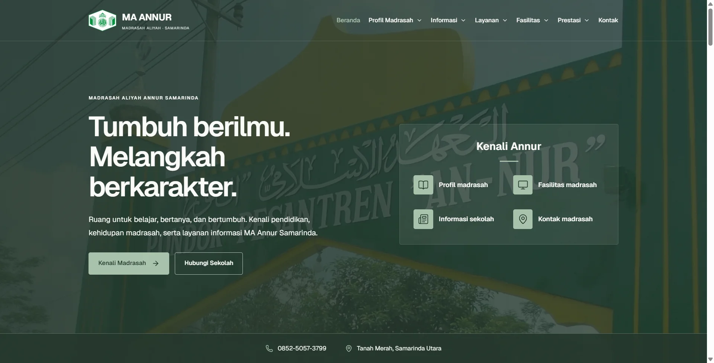
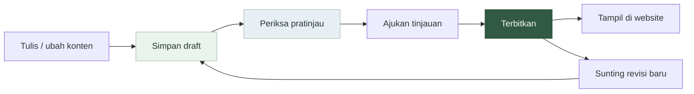

<div align="center">


# Web Sekolah Modern

**Website sekolah yang hidup. Pengelolaan konten yang mudah.**

Portal informasi dan CMS untuk **Madrasah Aliyah Annur Samarinda**, dengan tampilan responsif, animasi scroll, dan alur publikasi yang menjaga draft tetap privat.


[Fitur](#fitur) · [Pratinjau](#pratinjau) · [Mulai](#mulai) · [Panduan CMS](#panduan-cms) · [Pengujian](#pengujian)

</div>

> **Status repositori:** dokumentasi dan pratinjau tersedia. Kode aplikasi belum dipublikasikan. Panduan instalasi di bawah berlaku setelah kode tersedia.

---

## Pratinjau



> Palet sage, cream, dan forest; tipografi modern; foto sekolah; serta perpindahan section dengan parallax. Sebagian materi masih berupa contoh yang perlu disahkan sekolah.

## Fitur

| Untuk pengunjung | Untuk operator sekolah |
| --- | --- |
| Profil, sejarah, visi-misi, dan fasilitas | Editor beranda per bagian dengan petunjuk |
| Berita berbentuk kartu dan halaman artikel | Kelola halaman, berita, guru, agenda, galeri, FAQ, dan dokumen |
| Pengumuman, agenda, galeri, dan unduhan | Kelola navbar, submenu, logo, kontak, serta footer |
| Navigasi desktop dan ponsel | Pilih gambar secara visual, cari konten, dan gunakan filter status |
| Animasi teks, parallax, dan smooth scrolling | Autosave draft, pemulihan isian, dan pembatalan penghapusan item |
| Dukungan keyboard dan reduced motion | Pratinjau desktop/ponsel, tinjauan, publikasi, dan riwayat revisi |

**Fokus saat ini:** website informasi sekolah dan CMS. PPDB online, rapor, keuangan, dan alumni belum termasuk.

## Alur publikasi



Draft dan revisi yang sedang dikerjakan tidak mengganti versi yang sudah tayang. Konten yang dihapus masuk Sampah dan dapat dipulihkan sebagai draft.

## Teknologi

| Bagian | Teknologi |
| --- | --- |
| Aplikasi | Next.js App Router · React · TypeScript |
| Tampilan | Tailwind CSS · Lucide · Geist |
| Interaksi | GSAP · React Bits · Lenis · jQuery Slim |
| Autentikasi | Better Auth · TOTP/MFA wajib |
| Database | MariaDB · mysql2 · migrasi SQL berversi |
| Media | Sharp untuk gambar · pdf-lib untuk validasi PDF |
| Pengujian | Node.js Test Runner · Playwright · Chrome |

## Mulai

**Prasyarat:** Node.js 24 LTS, npm, serta Docker Desktop dengan Linux Engine aktif untuk menjalankan database.

```bash
git clone https://github.com/abexziero/web-sekolah-modern.git
cd web-sekolah-modern
npm ci
```

<details open>
<summary><strong>1 · Lihat tampilan tanpa database</strong></summary>

```bash
npm run dev
```

Buka [localhost:3000](http://localhost:3000). Tanpa konfigurasi database, halaman publik menggunakan materi contoh. Dashboard memerlukan langkah persiapan database di bawah.

</details>

<details>
<summary><strong>2 · Siapkan database dan CMS lokal</strong></summary>

```bash
npm run setup:local
npm run db:up
npm run db:migrate
npm run accounts -- create
npm run dev
```

- `setup:local` membuat `.env.local` dengan secret acak dan menolak menimpa file yang sudah ada.
- Pilih peran `super_admin` untuk akun pertama. Password dimasukkan tersembunyi melalui terminal; tidak ada akun/password bawaan.
- Masuk melalui [localhost:3000/admin/login](http://localhost:3000/admin/login), lalu aktifkan autentikator TOTP dan simpan kode pemulihan.
- MariaDB development berjalan di `127.0.0.1:3307`. Database tes menggunakan port `3308`.
- Pengguna PowerShell dapat memakai `npm.cmd` jika `npm` diblokir kebijakan eksekusi script.

</details>

<details>
<summary><strong>3 · Build dan jalankan versi produksi lokal</strong></summary>

```bash
npm run typecheck
npm run build
npm run start
```

Untuk server publik, atur environment, domain, HTTPS, reverse proxy, dan backup database/media terlebih dahulu. `SITE_URL` mengatur URL canonical/sitemap; aktifkan `SITE_INDEXABLE=true` setelah konten dan peluncuran siap.

</details>

## Panduan CMS

<details>
<summary><strong>Saya baru pertama kali mengelola website</strong></summary>

1. Buka **Panduan persiapan website** di dashboard.
2. Lengkapi identitas, logo, alamat, dan kontak resmi.
3. Siapkan halaman profil serta fasilitas.
4. Atur foto gerbang dan teks beranda.
5. Sesuaikan menu dengan halaman tujuan yang siap.
6. Periksa pratinjau, ajukan tinjauan, lalu terbitkan.

Tombol **Siapkan konten awal sebagai draft** menyediakan materi contoh tanpa otomatis menerbitkannya. Periksa dan ganti materi tersebut dengan informasi resmi sekolah.

</details>

<details>
<summary><strong>Apa bedanya Super Admin dan Editor?</strong></summary>

| Peran | Akses |
| --- | --- |
| **Super Admin** | Mengelola seluruh konten, media, pengaturan, menu, publikasi, serta akun |
| **Editor** | Membuat dan mengubah berita sendiri, membuka pratinjau, dan mengajukan tinjauan |

MFA wajib untuk kedua peran. Penggantian peran/status akun mencabut sesi; Super Admin aktif terakhir dilindungi.

</details>

<details>
<summary><strong>Bagaimana penyimpanan draft bekerja?</strong></summary>

Konten yang sudah dibuat dapat disimpan otomatis ketika isian valid. Isian baru atau belum lengkap ditampung sementara pada tab yang sama dan dapat dipulihkan. Menutup tab dapat menghilangkan isian sementara; gunakan **Simpan draft** sebelum meninggalkan pekerjaan.

Autosave tidak menerbitkan konten. Konflik versi ditolak agar perubahan operator lain tidak tertimpa.

</details>

<details>
<summary><strong>Bagaimana gambar dan dokumen dikelola?</strong></summary>

Pilih melalui perpustakaan media. Gambar JPEG/PNG/WebP diperiksa, diproses menjadi WebP, dan metadatanya dibuang. PDF diperiksa sebelum disimpan. Media draft bersifat privat; file terbit mengikuti akses publik konten yang memakainya.

Media tersimpan di `.local-data/media/`, di luar folder publik dan build. Cadangkan direktori media bersama database. File yang masih dirujuk revisi dilindungi dari penghapusan.

</details>

## Keamanan

- MFA/TOTP, kode pemulihan sekali pakai, pembatasan percobaan, dan pencabutan sesi.
- Pemeriksaan peran, kepemilikan konten, asal permintaan, serta validasi server.
- Query database terparameterisasi dan akun database non-root.
- Database remote memerlukan TLS dengan verifikasi sertifikat/hostname.
- Draft dan pratinjau privat; publikasi memakai snapshot revisi.
- Konfigurasi rahasia dibuat lokal. `.env.example` hanya berisi placeholder.

Implementasi sudah diuji lokal; audit keamanan dan konfigurasi hosting produksi tetap diperlukan sebelum peluncuran.

## Pengujian

```bash
# Tanpa database
npm run test:backend
npm run typecheck

# Dengan database tes terpisah
npm run db:test:up
npm run db:migrate:test
npm run test:db

# Browser: jalankan bergantian karena menggunakan folder build yang sama
npm run test:dashboard
npm run test:e2e

# Kembalikan build ke konfigurasi aplikasi setelah tes browser
npm run build
```

Playwright menggunakan Chrome lokal. Server tes publik memakai port `3100`; dashboard memakai `3101`.

**Verifikasi lokal terakhir:** 22 tes unit, 15 integrasi database, 14 browser dashboard, dan 34 browser publik lolos — **85 skenario**. Build dan pemeriksaan TypeScript juga berhasil. Hasil ini bukan hasil pengujian hosting produksi.

## Struktur proyek

```text
app/          Halaman publik, dashboard, dan route API
components/   Komponen tampilan, animasi, dan formulir CMS
lib/          Validasi, konten awal, autentikasi, dan layanan database
migrations/   Skema database serta migrasi berversi
public/       Font, gambar, dan dokumen contoh
scripts/      Persiapan lokal, migrasi, akun, serta runner pengujian
tests/        Pengujian unit, integrasi database, dan browser
```

## Aset dan atribusi

- Identitas serta foto madrasah digunakan untuk implementasi MA Annur Samarinda; penggunaan ulang memerlukan izin pemilik terkait.
- Foto ilustrasi Pexels: kredit dan sumber disertakan pada aset aplikasi.
- Font Geist: SIL Open Font License.
- Komponen visual diadaptasi dari React Bits; atribusi sumber berada pada komponen terkait.
- Kode aplikasi belum diberi lisensi distribusi. Dependency dan aset pihak ketiga mengikuti lisensinya masing-masing.

---

<div align="center">

**Informasi mudah ditemukan. Konten mudah diperbarui.**

[↑ Kembali ke atas](#web-sekolah-modern)

</div>
